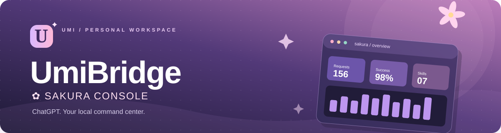

# UmiBridge · Sakura Console

**Your PC. Your skills. Your command center.**

A personal Windows MCP bridge connecting ChatGPT and Gemini on the web to your files and PowerShell, with a private anime-inspired dashboard and an optional local Codex Skill Center.

**[English](#english) · [Tiếng Việt](#tieng-viet) · [Releases](https://github.com/TDUmii/umi-bridge/releases) · [Vietnamese user manual](LOCAL-README.vi.md)**

---

## English

> [!WARNING]
> **Beta software - powerful local access.** After you authorize the MCP connection, your connected assistant can read and modify local files and run PowerShell commands on your computer. Use trusted accounts, verify actions before allowing them, and back up important files. Never disclose your connection code, credentials, tokens, or private local logs.

### What is UmiBridge?

UmiBridge runs an MCP server on your Windows computer and connects it to ChatGPT or Gemini through HTTPS. OAuth is the standard connection; Gemini also has an optional private paired URL. A persistent Microsoft Dev Tunnel is recommended, with Cloudflare Quick Tunnel available for temporary use. Both assistants use the same server and tunnel. Its **Sakura Console** dashboard is available *only on the local computer*.

Connect through each product's native custom MCP app settings. **No model API key or browser extension is needed** when your account has access to that feature.

| Feature | What you get |
| --- | --- |
| Local file tools | Read, write, edit, move, search, inspect, and create files or directories |
| Shell tools | Execute PowerShell commands and retrieve bounded output |
| MCP authorization | OAuth, PKCE, Dynamic Client Registration (DCR), scoped tokens |
| Optional Gemini pairing | A private credential URL for accounts where Google's OAuth linking cannot complete |
| Web assistants | Native custom MCP connections for ChatGPT and eligible Gemini accounts |
| Multi-device Hub | Pair multiple Windows Agents to one Hub/account and route each job by `device_id` |
| Sakura Console | English-by-default admin UI, optional Vietnamese switch, light/dark themes |
| Analytics | Request history, tool usage, outcome counts, average/P95 latency and a 12-hour activity chart |
| Chat associations | Manually attach a ChatGPT or Gemini conversation/share link to a request |
| Skill Center | Discover installed Codex/Agents skills, preview SKILL.md, enable/disable them, and add custom skill folders |

**Important:** MCP does not identify the conversation that produced a request. Provider labels identify the connected client; chat associations must be created manually. Enabling a skill does not execute its scripts.

### Requirements

- **Windows 10 or Windows 11 (x64)** and an internet connection.
- Node.js 22.12.0 or newer is optional. The one-click launcher downloads the latest official Windows x64 LTS runtime when a compatible Node.js is not already available.
- A ChatGPT or Gemini account with access to **custom MCP apps**; the standard connection uses OAuth. See the provider-specific setup below for current availability.

No Python, Docker, IDE, or Administrator account is required. The GitHub ZIP contains the source and a one-click bootstrap installer; it is not an MSI or a system-wide Windows installer.

### Install on a new Windows computer

**1. Download the source.** Choose **Code → Download ZIP** from [the repository](https://github.com/TDUmii/umi-bridge), extract it to a normal folder, or clone it:

~~~powershell
git clone https://github.com/TDUmii/umi-bridge.git
cd umi-bridge
~~~

**2. Install and start with one click.** Open the extracted folder and double-click **`UmiBridge.cmd`**. It is the only daily entry point and automatically:

1. Uses a compatible system Node.js, or downloads the latest official Node.js LTS runtime into the project only.
2. Installs the locked npm dependencies with `npm ci`.
3. Checks the JavaScript source.
4. Downloads and verifies the tunnel runtime when it is missing.
5. Reuses the saved Microsoft Dev Tunnel when its login works; if its project token has expired, it renews the GitHub-backed login and retries before starting a temporary Quick Tunnel.
6. Starts UmiBridge in the background and opens the local dashboard.

The first run needs internet access. It does not change the system PowerShell execution policy or install files globally.

The terminal stays open after startup and prints a redacted one-line record whenever a request arrives. Use the endpoint and connection code in `.local-data/CONNECT.txt` for the first OAuth connection. After that, opening **`UmiBridge.cmd`** is enough: it updates clean source trees, repairs a broken runtime, checks the tunnel/host, starts the shared gateway, opens `/admin`, and monitors requests without showing command arguments or output. Press `Ctrl+C` to stop watching; use `Stop-ChatGPT.cmd` when you want to stop the gateway.

**One ready PowerShell session per machine:** the backend and each Agent prepare a hidden PowerShell host at startup, then queue incoming commands through that same process. Ordinary requests reuse its process instead of launching a new CMD/PowerShell window. Global PowerShell variables and environment changes can carry into later commands; an explicit `cwd` sets the working directory for that command. A timeout, explicit `exit`, or shell crash resets the session, so a later command uses a fresh session. The launcher monitor stays open, while command stdout, stderr and exit codes remain available through MCP and dashboard history. An application deliberately launched by a command can still show its own GUI.

Within incoming commands, `Start-Process` (including `start` and `saps`) defaults to `-WindowStyle Hidden`. Explicit `-NoNewWindow` remains supported; use `-WindowStyle Normal` when you intentionally want an application to appear. Invoke console programs directly when their stdout/stderr should return in the tool result.

For an advanced/manual setup, run the following in the directory containing `Setup-Local.ps1`:

~~~powershell
powershell.exe -NoProfile -ExecutionPolicy Bypass -File .\Setup-Local.ps1
~~~

`Setup-Local.ps1` performs the same steps without launching the server. Double-click `Start-ChatGPT.cmd` afterward for the first OAuth connection. Keep its console window open while copying the HTTPS **Server URL** ending in `/mcp`, OAuth/DCR details, your locally generated connection code, and the private dashboard address. After OAuth is complete, use `UmiBridge.cmd` so the server runs hidden and the dashboard opens without covering the screen.

### Set up a persistent connection (recommended)

Double-click **`Setup-Stable-Connection.cmd`** once before creating your ChatGPT or Gemini app if you want a fixed address. It installs the signed Microsoft Dev Tunnels client, opens GitHub sign-in, creates a persistent tunnel and records the host. No domain purchase is needed. After that, **`UmiBridge.cmd`** probes the project API, renews an expired GitHub-backed login and reuses the host automatically. If renewal is unavailable, it falls back to a temporary Quick Tunnel and keeps the gateway available; run this setup again when you want to restore the fixed address. Use the `/mcp` URL from the local dashboard and the connection code in `.local-data/CONNECT.txt`. A browser may show Microsoft's first-visit tunnel notice; review it yourself before continuing to OAuth.

If ChatGPT already uses your persistent endpoint, reuse it for Gemini OAuth. Optional Gemini pairing uses a private path on the same tunnel. There is no second server, launcher mode or tunnel to choose.

### Connect to ChatGPT

1. In ChatGPT, open **Settings → Plugins/Apps / custom MCP connectors** (actual wording may vary by plan and release).
2. Add a new custom MCP server, optionally naming it **UmiBridge**.
3. Copy the exact HTTPS **Server URL** ending in `/mcp` from the local dashboard.
4. Select **OAuth** with **Dynamic Client Registration (DCR)**. Leave Client ID / Client Secret blank if registration is automatic.
5. Select the `desktop` and `offline_access` scopes if the interface offers them.
6. Follow the consent flow and enter the connection code on UmiBridge's authorization page. Keep the code out of the conversation.
7. Test the connection by asking ChatGPT to **read a non-sensitive file**.

Without stable setup, Quick Tunnel URLs can change after every restart. A reconnect button cannot repair a deleted hostname: create a connection with the current URL. With a persistent Dev Tunnel, both the URL and issuer-bound OAuth grants survive restarts. Access tokens last 15 minutes and rotate through a refresh token valid for up to 30 days; clients advertising the refresh grant receive one even when they request only `desktop` scope. Revocation is persisted. Pending consent and single-use codes are never restored after restart.

Microsoft Dev Tunnels is a public preview service and needs a valid Microsoft/GitHub sign-in. Microsoft removes a tunnel after 30 days without activity. The launcher renews an expired hosting token when possible; if that sign-in cannot be renewed, rerun `Setup-Stable-Connection.cmd` and it reuses the same tunnel. See [Microsoft's CLI reference](https://learn.microsoft.com/en-us/azure/developer/dev-tunnels/cli-commands) and [FAQ](https://learn.microsoft.com/en-us/azure/developer/dev-tunnels/faq). For ChatGPT's current menus and account policies, see [OpenAI's custom MCP guide](https://developers.openai.com/api/docs/guides/custom-mcp-server).

### Connect to Gemini on the web

1. Double-click **`Setup-Gemini.cmd`**. It checks dependencies, starts or reuses UmiBridge in the background, copies the current connection URL to your clipboard, and opens [Gemini Connected Apps in English](https://gemini.google.com/customize/connectors?hl=en). It uses OAuth `/mcp` unless private pairing is already configured.
2. Find **Custom apps → Add a custom app**. Some accounts show localized controls such as **Tùy chỉnh → Tạo ứng dụng tùy chỉnh**.
3. Paste the endpoint and select **Next / Tiếp theo**. UmiBridge supports DCR, so you can leave advanced Client ID and Client Secret fields empty.
4. For OAuth, complete Google's account-linking and consent screens. Enter the connection code on UmiBridge's authorization page if prompted; find it in `.local-data/CONNECT.txt` or the visible `Start-ChatGPT.cmd` terminal. The dashboard shows the endpoint, not the code.
5. Open a Gemini chat or task, type `@`, and select the connected UmiBridge app. Start by asking it to read a non-sensitive file in your project.
6. Review Gemini's confirmation before allowing file changes or commands. Google currently requires manual confirmation for write actions.

Google's published Custom Apps requirements currently specify a personal Google Account, age 18+, US availability, English, and Keep Activity enabled. Rollout and localized UI can vary by account; verify that **Custom apps** is visible on your account. A missing menu cannot be enabled by changing UmiBridge. See [Google's current Custom Apps guide](https://support.google.com/gemini/answer/17209137). This is the Gemini web integration; it does not require Gemini CLI or a Gemini API key.

**Optional private pairing:** if Google's OAuth account-linking window stays blank, run **`Setup-Gemini-Paired.cmd`**. It creates a 32-byte random secret in protected `.local-data/gemini-pairing-secret.txt`, restarts this bridge while preserving existing OAuth grants, and copies the exact private URL stored in `.local-data/GEMINI-CONNECT.txt`. Paste it **only into Gemini's MCP Server URL field**, then review the normal custom-app risk confirmation. This connection uses `/gemini/<random>/mcp` directly instead of a separate OAuth account-linking flow. Later runs of `Setup-Gemini.cmd` reuse the configured paired URL.

**Treat the entire paired URL like a password.** Anyone who has it can use the exposed tools. It has no OAuth expiry, refresh cycle, or per-client grant; it stays usable until revoked. Keep it out of chats, screenshots and source control. To revoke it, delete `.local-data/gemini-pairing-secret.txt`, run `Stop-ChatGPT.cmd`, then `UmiBridge.cmd`. You can then reconnect Gemini with the regular OAuth endpoint. The regular `/mcp` route continues to require OAuth.

### Link more than one Windows computer to the same Hub

The computer running `UmiBridge.cmd` is the **Hub**. It owns the tunnel, OAuth, dashboard and request history. Other Windows computers run the lightweight outbound **Agent**; they do not need a public port or a second tunnel. ChatGPT and Gemini see the same device tools and choose a target with `device_id`.

1. Start the Hub and open `http://127.0.0.1:43127/admin`, then choose **Devices → Create pairing code**.
2. Copy the one-time code and the Hub's current HTTPS origin from the local dashboard. The code expires after ten minutes and is never saved in Git.
3. On the target computer, copy the project source and run **`Pair-Agent.cmd`**. Enter the Hub origin, the one-time code and a recognizable device name. The Agent stores its generated key only in that computer's ignored `.local-data/agent-config.json`.
4. Start **`UmiBridge-Agent.cmd`** on that computer and leave its small monitor window running. It keeps an outbound connection, polls for jobs, executes them locally with hidden PowerShell, and sends stdout, stderr, exit code or file results back to the Hub.
5. In ChatGPT or Gemini, reconnect or refresh the existing UmiBridge app once so it reloads the beta.9 tool list. Then call `list_devices`, and pass the returned `device_id` to `run_on_device`, `read_file_on_device`, `write_file_on_device` or the other remote tools. The Devices page shows online state and recent job history; **Revoke** immediately invalidates an Agent key.

The Hub does not copy a target computer's files into the server. Only the bounded result of the requested operation returns through the authenticated MCP connection. A target can be offline without exposing a listening service; jobs are accepted only while its Agent heartbeat is online. Do not share the Hub URL, pairing code or Agent config file.

**Live Gemini verification (2026-10-20):** the native custom-app flow in **Task / Flash** read a local fixture, wrote a new file, read it back, and ran PowerShell with exit code 0. The returned markers were checked against disk and the gateway history. Earlier attempts reported `Transport for env PROD not found in configuration`; after refreshing/recreating the app configuration, real calls reached the gateway. The exact cause of that earlier configuration error has not been isolated. A connected-app badge alone is insufficient; validate an actual file operation. See [verification details](GEMINI-VERIFICATION.md).

### Sakura Console - languages, analytics and chat links

**Gemini browser extension (experimental beta.12):** run `Setup-Gemini-Browser.cmd` for MCP SuperAssistant and a private loopback Streamable HTTP connection. The setup verifies the authenticated local MCP connection before opening Gemini. Live Gemini **Conversation / 4 Argon / High** has produced an MCP tool card, executed `list_directory` against a real local folder, returned the actual result through **Run → Insert**, and summarized it correctly. **Task / Flash** has additionally read, created and edited files, executed hidden PowerShell with stdout/stderr/exit code, and read fresh data after a gateway restart through the extension. If Gemini says it cannot access a local drive while the extension is connected, apply the one-time [Custom Instructions recipe](GEMINI-CUSTOM-INSTRUCTIONS.md). This uses the existing tools/history without another npm proxy or model API key. See [setup](GEMINI-BROWSER.vi.md), [short prompt](GEMINI-EXTENSION-PROMPT.md) and [verification report](GEMINI-EXTENSION-VERIFICATION.md). ChatGPT-only **beta.4 remains Latest**.

On the same Windows computer, open **http://127.0.0.1:43127/admin**. The dashboard cannot be opened through the public tunnel.

The interface **defaults to English**. Use the **English / Tiếng Việt** language selector in the top bar to switch instantly. Your selection is saved in this browser, and the language changes independently of the light/dark theme.

From the sidebar, you can browse Overview, Analytics, Linked chats, Skill Center and Request history. Search and filter requests, inspect redacted arguments and copy your connection endpoint. Auto-refresh runs every 20 seconds when enabled.

**500 is a recent-history window, not a request quota.** The gateway continues to execute request 501 and later. Total received, successful and failed counters include all recorded calls since you last cleared history and are restored from the local journal after a restart. Latency, charts and tool rankings cover the latest 500 records; the activity table loads the latest 200. Sanitized records are appended to `.local-data/request-history.jsonl`, so this local file grows until you choose **Clear history**, which also resets the totals and removes manually linked chats. No history or counter is sent to GitHub.

Request history displays the client/provider where available. To associate a chat, open **Request history → Details / Chat**, paste its ChatGPT or Gemini conversation/share URL, then choose **Save link**. Supported forms include `https://chatgpt.com/c/...`, `https://chatgpt.com/share/...`, `https://gemini.google.com/app/...`, `https://gemini.google.com/share/...`, and Gemini's copied short link `https://g.co/gemini/share/...`. The conversation ID is extracted only from the URL that *you* supplied. You can unlink it at any time.

### Skill Center - built in, expandable and local

Skills are detected from the current machine's common directories:

- `%USERPROFILE%\.codex\skills`
- `%USERPROFILE%\.agents\skills`
- `.agents/skills` inside the project directory
- Any absolute local skill folder you explicitly add from the dashboard

UmiBridge recognizes these **seven suggested skill names** when installed: `ui-ux-pro-max`, `impeccable`, `frontend-checklist-global`, `playwright-cli`, `ponytail`, `api-security-testing`, and `find-security-vulnerabilities-in-code`. Recommended skills default to enabled when discovered; other skills default to disabled until you enable them.

To add your own skill, create/download a trusted folder containing `SKILL.md`, open **Skill Center**, enter its absolute folder path and select **Add skill**. You can preview, enable/disable, or unlink it without deleting the original source.

Through MCP, ChatGPT or Gemini can use `list_skills` and `read_skill` to list and read the instructions of enabled skills. **Scripts do not execute automatically.** Skill instructions are untrusted content; review them before asking the assistant to run commands. Do not store secrets inside SKILL.md.

### Stop, restart and troubleshoot

To restart, run `Stop-ChatGPT.cmd`, wait for the stop confirmation, then run `UmiBridge.cmd` again. Use `Start-ChatGPT.cmd` when you need to see the connection URL and startup diagnostics. Refresh the dashboard with **Ctrl + Shift + R** if you still see an older version.

| Symptom | What to do |
| --- | --- |
| `EADDRINUSE` or an occupied named pipe | Run `Stop-ChatGPT.cmd` before restarting; do not kill every `node.exe` |
| `node` / `npm` command not found | Double-click `UmiBridge.cmd` again with internet access; it installs a project-local Node.js runtime automatically |
| `cloudflared.exe` is missing | Rerun `Setup-Local.ps1` with internet access |
| Background start fails | Read `.local-data/server-error.log`, then run `Start-ChatGPT.cmd` once to see the startup error |
| Dashboard will not load | Confirm the launcher is running and open the loopback URL on the host computer |
| ChatGPT reports a 401 or connection failure | Verify the saved `/mcp` URL matches the dashboard. Run `Setup-Stable-Connection.cmd` for a persistent address, then authorize the matching app once |
| Gemini has no Custom apps section | Check Google's current eligibility and account rollout. UmiBridge cannot turn on a product feature that your account does not expose |
| Gemini cannot connect | Rerun `Setup-Gemini.cmd` to copy the live URL, complete the selected connection flow, and keep UmiBridge running |
| Google's OAuth linking window stays blank | Try the optional `Setup-Gemini-Paired.cmd` flow above; keep its credential URL private |
| Browser says `DNS_PROBE_FINISHED_NXDOMAIN` | The old temporary hostname no longer exists. Reconnecting that app will not change its URL; create a new connection with the current endpoint |
| Skill does not appear | Check the directory contains a regular `SKILL.md` file no larger than 128 KiB; add it manually if outside the standard folders |
| The UI is not in English | Select **English** in the top bar; the default applies until a browser-specific preference is saved |

### Privacy and security

- The admin dashboard is **loopback-only**. The public HTTPS tunnel exposes the OAuth-protected MCP service, **not** your dashboard.
- Runtime credentials, OAuth state, request history, chat associations and skill preferences are stored under `.local-data/`, which is excluded from version control.
- Optional Gemini pairing credentials, including `gemini-pairing-secret.txt` and `GEMINI-CONNECT.txt`, also stay under `.local-data/` and must not be shared.
- OAuth clients and token grants are stored atomically under the local account's protected directory and are accepted only for their original issuer. Keep this directory private; deleting `oauth-state.json` requires OAuth authorization again.
- `.runtime/`, `node_modules/` and the downloaded `local-bin/` are also ignored and excluded from source releases.
- Keep browser profiles, account data, personal tunnel URLs and runtime logs out of source bundles and public bug reports.
- Recorded request arguments use **best-effort redaction**, not guaranteed removal of arbitrary secrets embedded inside commands or strings. Avoid sending secrets inside tool inputs.
- `run_command` history stores the command, working directory, exit code and bounded `stdout`/`stderr` locally so you can inspect it in `/admin`; output is capped and receives basic secret/path redaction.
- The latest 500 records are retained in memory for analytics, with the latest 200 loaded by the activity table. The local append-only journal restores total counters across restarts; 500 never limits request execution. **Clear history** deletes the journal and resets its totals. It is **not a conversation archive**.
- Only the user-selected enabled skill's SKILL.md text is sent to the authorized MCP client when requested. Personal skill folders are **not uploaded to this repository**.
- You may disconnect OAuth authorization and stop the launcher at any time.

### Build and test

~~~powershell
npm ci --ignore-scripts --no-audit --no-fund
npm run build
npm run local:test
~~~

Project files: `scripts/chatgpt-backend.mjs` (MCP tools), `scripts/local-web-gateway.mjs` (OAuth and admin API), `scripts/local-admin.mjs` (request logging and chat associations), `scripts/skill-library.mjs` (local skills), `scripts/admin-dashboard.html` (dashboard), and `scripts/admin-i18n.js` (language switch).

**License:** [MIT](LICENSE) · **Status:** Beta (one-click bootstrap available; no system-wide MSI installer).

---

# UmiBridge ✿ Sakura Console - Hướng dẫn sử dụng chi tiết

**Phiên bản nhánh thử nghiệm:** v0.1.0-beta.12. **Latest dành cho ChatGPT:** beta.4. **Hệ điều hành:** Windows 10/11 x64.
**Repository:** https://github.com/TDUmii/umi-bridge  
**English / Tiếng Việt:** [README.md](README.md) (English first, Vietnamese below)
**Điều khiển:** ChatGPT web và Gemini web (MCP, OAuth hoặc URL ghép nối Gemini riêng). **Quản trị:** http://127.0.0.1:43127/admin

> [!WARNING]
> Dự án cho phép trợ lý đã kết nối thao tác với file và thực thi PowerShell trên máy đã xác thực. Chỉ cấp quyền cho tài khoản bạn tin cậy. Nên sao lưu dữ liệu quan trọng, không tiết lộ mã kết nối và chỉ chạy lệnh mà bạn đã hiểu rõ.

UmiBridge dùng kết nối MCP tùy chỉnh có sẵn trong ChatGPT hoặc Gemini. **Không cần API key của mô hình hay tiện ích trình duyệt** khi tài khoản có tính năng này. Hai dịch vụ dùng chung server và tunnel; OAuth dùng `/mcp`, Gemini có thêm URL ghép nối riêng tùy chọn. Dashboard vẫn chỉ mở trên máy local.

### Liên kết nhiều máy Windows vào một tài khoản

Máy chạy `UmiBridge.cmd` là **Hub**. Hub giữ tunnel, OAuth, dashboard và lịch sử lệnh. Các máy khác chỉ chạy **Agent** kết nối outbound nên không cần mở port công khai hoặc tạo tunnel riêng. ChatGPT và Gemini dùng chung danh sách công cụ và định tuyến bằng `device_id`.

1. Mở dashboard `http://127.0.0.1:43127/admin`, vào **Devices → Create pairing code**.
2. Sao chép mã một lần và địa chỉ HTTPS hiện tại của Hub. Mã hết hạn sau mười phút và không được đưa lên Git.
3. Trên máy đích, chép source rồi nhấp đúp **`Pair-Agent.cmd`**. Nhập địa chỉ Hub, mã ghép nối và tên dễ nhận biết. Agent lưu khóa sinh ra tại `.local-data/agent-config.json`, thư mục này đã bị loại khỏi Git.
4. Nhấp đúp **`UmiBridge-Agent.cmd`** trên máy đích và để cửa sổ monitor chạy. Agent giữ kết nối outbound, nhận job, chạy PowerShell ẩn trên chính máy đó rồi gửi stdout, stderr, mã thoát hoặc kết quả file về Hub.
5. Trong ChatGPT hoặc Gemini, kết nối lại hoặc làm mới app UmiBridge một lần để nạp danh sách tool beta.9. Sau đó gọi `list_devices`, rồi truyền `device_id` vào `run_on_device`, `read_file_on_device`, `write_file_on_device` hoặc công cụ remote tương ứng. Mục Devices hiển thị online và lịch sử job; dùng **Revoke** để vô hiệu hóa khóa Agent.

Hub không sao chép toàn bộ file của máy đích. Chỉ kết quả giới hạn của thao tác được gửi qua MCP đã xác thực. Máy đích có thể offline mà không cần mở dịch vụ lắng nghe; Hub chỉ nhận job khi heartbeat Agent còn online. Không chia sẻ URL Hub, mã ghép nối hoặc file cấu hình Agent.

## 1. Cài lần đầu trên một máy Windows khác

### Chuẩn bị

- Windows 10/11 x64, Internet.
- Có Internet để chạy launcher một lần. Node.js **22.12.0+** là tùy chọn; nếu máy chưa có bản phù hợp, `UmiBridge.cmd` sẽ tự tải bản LTS Windows x64 chính thức vào thư mục dự án.
- Tài khoản ChatGPT hoặc Gemini có quyền thêm ứng dụng MCP tùy chỉnh. Kết nối thông thường dùng OAuth; điều kiện và lựa chọn Gemini được nêu tại mục 3.

- Không cần Python, Docker, VS Code hay quyền Administrator cố định. Nếu máy công ty áp dụng chính sách hạn chế cài đặt/chạy PowerShell, bạn cần làm đúng quy định quản trị của máy.

### Tải mã nguồn

Tại GitHub, chọn **Code → Download ZIP**, sau đó giải nén vào thư mục thông thường (ví dụ `D:\Tools\UmiBridge`). Cũng có thể sử dụng Git:

~~~powershell
git clone https://github.com/TDUmii/umi-bridge.git
cd umi-bridge
~~~

### Cài đặt một lần bằng cách nhấp đúp

Mở thư mục đã giải nén và nhấp đúp **`UmiBridge.cmd`**. Đây là file duy nhất cần mở hằng ngày; không cần mở PowerShell và không cần cài Node.js trước. Launcher sẽ tự:

1. Dùng Node.js sẵn có nếu đạt phiên bản tối thiểu, hoặc tải Node.js LTS chính thức vào `.runtime/`.
2. Cài dependency đúng theo `package-lock.json`.
3. Kiểm tra cú pháp mã nguồn.
4. Tải và kiểm tra runtime tunnel khi máy chưa có.
5. Dùng lại Dev Tunnel cố định; nếu token của tunnel hết hạn, launcher tự gia hạn đăng nhập GitHub rồi thử lại trước khi chuyển sang Quick Tunnel tạm.
6. Khởi chạy UmiBridge chạy nền rồi mở dashboard local.

Lần đầu cần Internet. Bộ cài không đổi execution policy toàn hệ thống và không cài phần mềm vào `Program Files`.

Terminal sẽ giữ nguyên sau khi khởi động và in một dòng đã che thông tin mỗi khi có request mới. Lấy `Server URL` và mã kết nối OAuth trong `.local-data/CONNECT.txt`. Sau đó chỉ cần nhấp đúp **`UmiBridge.cmd`**: launcher tự cập nhật khi source sạch, sửa runtime/build, kiểm tra tunnel/host, chạy gateway dùng chung cho ChatGPT và Gemini, mở dashboard và theo dõi request mà không in tham số hay output lệnh. Nhấn `Ctrl+C` để dừng theo dõi; dùng `Stop-ChatGPT.cmd` khi muốn dừng gateway.

**Một phiên PowerShell sẵn sàng trên mỗi máy:** backend và từng Agent chuẩn bị một PowerShell chạy ẩn ngay khi khởi động, sau đó xếp hàng lệnh để chạy qua cùng tiến trình đó. Request thông thường dùng lại phiên này, không mở thêm cửa sổ CMD/PowerShell. Biến PowerShell toàn cục và thay đổi biến môi trường có thể được dùng ở lệnh sau; `cwd` được truyền trong request sẽ đặt thư mục làm việc cho lệnh đó. Khi lệnh timeout, gọi `exit` hoặc shell gặp lỗi dừng, phiên được đặt lại và lệnh kế tiếp dùng host mới. Cửa sổ monitor của launcher vẫn mở; stdout, stderr và exit code được trả qua MCP và lưu trong lịch sử dashboard. Ứng dụng được câu lệnh chủ động mở vẫn có thể hiện giao diện riêng.

Trong lệnh nhận từ chat, `Start-Process` (kể cả `start` và `saps`) mặc định dùng `-WindowStyle Hidden`. Vẫn hỗ trợ `-NoNewWindow`; chỉ thêm `-WindowStyle Normal` khi muốn chủ động hiện giao diện ứng dụng. Gọi trực tiếp chương trình console khi cần lấy stdout/stderr về kết quả tool.

### Thiết lập thủ công nâng cao

Mở PowerShell tại thư mục chứa `Setup-Local.ps1`, chạy:

~~~powershell
powershell.exe -NoProfile -ExecutionPolicy Bypass -File .\Setup-Local.ps1
~~~

Script thực hiện các bước giống bộ cài một lần nhưng không tự mở server.

Sau khi cài sẽ xuất hiện `.runtime/`, `node_modules/` và `local-bin/` trên máy. Các thư mục này không được đưa lên GitHub.

### Chạy

Lần đầu bộ cài sẽ mở `Start-ChatGPT.cmd`. Chờ thông báo `Server URL`, `Authentication: OAuth` và mã kết nối để kết nối ChatGPT. Sau khi OAuth hoàn tất, dùng `UmiBridge.cmd` để server chạy ẩn và dashboard tự mở, không che màn hình. Dùng lại `Start-ChatGPT.cmd` khi cần xem URL hoặc lỗi khởi động.

## 2. Kết nối ChatGPT bằng OAuth

**Khuyến nghị dùng địa chỉ cố định cho cả ChatGPT và Gemini:** nhấp đúp **`Setup-Stable-Connection.cmd`** một lần trước khi thêm ứng dụng. Script tải Dev Tunnels chính thức của Microsoft, kiểm tra chữ ký, mở đăng nhập GitHub và tạo tunnel cố định. Không cần mua tên miền. Các lần sau chỉ cần **`UmiBridge.cmd`**; launcher tự kiểm tra project API, gia hạn token đăng nhập GitHub khi cần và giữ nguyên host. Nếu gia hạn không thành công, launcher tự dùng Quick Tunnel tạm để gateway vẫn hoạt động; chạy lại setup này khi muốn khôi phục địa chỉ cố định.

Lấy URL `/mcp` tại dashboard và mã kết nối trong `.local-data/CONNECT.txt`. Khi trình duyệt hiện trang thông báo truy cập lần đầu của Microsoft, bạn tự xem và xác nhận trước khi vào OAuth. Nếu đã có app dùng link tạm cũ, tạo kết nối mới với URL cố định; nút “Kết nối lại” không tự thay URL đã lưu.

1. Mở ChatGPT và khu vực thêm **MCP server tùy chỉnh**. Tên menu có thể đổi tùy gói/phiên bản.
2. Nhập tên hiển thị **UmiBridge** (hoặc đặt tên tùy ý).
3. Dán nguyên **Server URL** kết thúc bằng `/mcp` từ dashboard hoặc cửa sổ UmiBridge. Sau thiết lập cố định, địa chỉ dùng `devtunnels.ms`; chế độ tạm dùng `trycloudflare.com`.
4. Chọn `OAuth`. Phần đăng ký client sử dụng `Dynamic Client Registration (DCR)`; không tự nhập Client ID hoặc Secret.
5. Nếu có các scope, bật `desktop` và `offline_access`.
6. Theo luồng consent trong trình duyệt, nhập **mã kết nối trên trang cấp quyền UmiBridge**. Lấy mã từ `.local-data/CONNECT.txt` hoặc cửa sổ `Start-ChatGPT.cmd` đang hiển thị. Dashboard chỉ hiện endpoint, không hiện mã.
7. Khi xác thực thành công, mở chat mới, chọn kết nối UmiBridge và thử một hành động đọc file không nhạy cảm.

**Mã kết nối không phải API key của ChatGPT.** Không gửi mã này qua tin nhắn hoặc công bố ảnh chụp màn hình chứa mã.

**Quick Tunnel** tạo URL HTTPS tạm. Sau khi dừng/chạy lại, cần xem `Server URL` mới và cập nhật plugin nếu URL đổi.

**Tunnel cố định:** giữ nguyên URL khi dùng lại cùng tunnel. OAuth được lưu tại máy và ràng buộc với URL đó, nên không mất chỉ vì khởi động lại. Access token vẫn hết hạn sau 15 phút; ChatGPT dùng refresh token để tự làm mới, kể cả khi chỉ yêu cầu scope `desktop`. Refresh token có hạn 30 ngày và được xoay sau mỗi lần dùng. Việc thu hồi quyền cũng được lưu. Request cấp quyền đang dở và mã xác thực dùng một lần không tồn tại qua lần khởi động lại.

Dev Tunnels là dịch vụ public preview. Microsoft xóa tunnel sau 30 ngày không hoạt động; launcher sẽ tự gia hạn token hosting khi có thể. Nếu không gia hạn được, chạy lại `Setup-Stable-Connection.cmd` để đăng nhập và dùng lại tunnel. Chi tiết: [CLI Microsoft](https://learn.microsoft.com/en-us/azure/developer/dev-tunnels/cli-commands), [FAQ](https://learn.microsoft.com/en-us/azure/developer/dev-tunnels/faq).

Tên menu và quyền thêm ứng dụng phụ thuộc phiên bản/tài khoản. Có thể đối chiếu với [hướng dẫn MCP chính thức của OpenAI](https://developers.openai.com/api/docs/guides/custom-mcp-server).

## 3. Kết nối Gemini web bằng ứng dụng MCP tùy chỉnh

Nếu ChatGPT đang dùng tunnel cố định, **dùng lại đúng URL đó cho Gemini qua OAuth**. Chế độ ghép nối tùy chọn bên dưới dùng đường dẫn riêng trên cùng tunnel. Không cần chạy server thứ hai, tạo tunnel khác hay đăng ký Gemini API.

1. Nhấp đúp **`Setup-Gemini.cmd`** trong thư mục UmiBridge. Script kiểm tra dependency, khởi động hoặc dùng lại server đang chạy dưới nền, sao chép URL kết nối hiện tại vào clipboard và mở [cài đặt ứng dụng Gemini bằng tiếng Anh](https://gemini.google.com/customize/connectors?hl=en). Script dùng OAuth `/mcp` nếu chưa cấu hình ghép nối riêng.
2. Tìm **Custom apps → Add a custom app**. Trên giao diện tiếng Việt có thể thấy **Tùy chỉnh → Tạo ứng dụng tùy chỉnh**.
3. Dán URL vừa sao chép, nhấn **Tiếp theo / Next**. UmiBridge hỗ trợ đăng ký client tự động (DCR), nên không cần tự điền Client ID hoặc Client Secret trong mục nâng cao.
4. Với OAuth, làm theo màn hình liên kết tài khoản Google và cấp quyền. Nếu trang UmiBridge yêu cầu mã kết nối, lấy mã trong `.local-data/CONNECT.txt` hoặc cửa sổ `Start-ChatGPT.cmd` đang hiển thị rồi nhập trên chính trang đó. Dashboard chỉ hiện endpoint, không hiện mã. Không dán mã vào cuộc trò chuyện.
5. Quay lại một chat hoặc tác vụ Gemini, gõ `@` và chọn ứng dụng UmiBridge vừa kết nối. Thử đọc một file không nhạy cảm trong dự án trước.
6. Khi Gemini chuẩn bị ghi file hoặc chạy lệnh, xem nội dung và xác nhận nếu đúng yêu cầu. Google hiện yêu cầu xác nhận thủ công với các thao tác ghi dữ liệu.

**Điều kiện tài khoản:** tài liệu Google hiện nêu tài khoản cá nhân, từ 18 tuổi, ở Mỹ, tiếng Anh và bật **Keep Activity**. Việc mở tính năng và ngôn ngữ giao diện có thể khác nhau giữa các tài khoản; một số tài khoản có nút tạo ứng dụng bằng tiếng Việt. Hãy kiểm tra trực tiếp mục **Custom apps / Tùy chỉnh** của bạn. UmiBridge không thể bật tính năng chưa được Google cấp cho tài khoản. Xem [hướng dẫn Custom Apps hiện tại của Google](https://support.google.com/gemini/answer/17209137).

Đây là kết nối ngay trên `gemini.google.com`; **không cần Gemini CLI, API key hay tiện ích trình duyệt**. Sau khi kết nối xong, các lần chạy hằng ngày chỉ dùng `UmiBridge.cmd` cho cả ChatGPT và Gemini.

### Tùy chọn khi cửa sổ OAuth của Google bị trắng

Nhấp đúp **`Setup-Gemini-Paired.cmd`** để tạo URL ghép nối riêng. Script tạo secret ngẫu nhiên 32 byte trong thư mục được bảo vệ `.local-data/gemini-pairing-secret.txt`, khởi động lại riêng UmiBridge và giữ các quyền OAuth đã cấp. URL đầy đủ được ghi vào `.local-data/GEMINI-CONNECT.txt`, sao chép vào clipboard và trang cài đặt Gemini được mở bằng tiếng Anh.

Dán URL này **chỉ vào ô MCP Server URL** khi tạo ứng dụng Gemini. Vẫn xem và xác nhận cảnh báo ứng dụng tùy chỉnh. Đường dẫn `/gemini/<random>/mcp` dùng chính URL để xác thực, không đi qua luồng liên kết tài khoản OAuth riêng. Sau khi cấu hình, `Setup-Gemini.cmd` sẽ tự dùng lại URL ghép nối.

**Coi toàn bộ URL như mật khẩu:** ai có URL đầy đủ có thể gọi các công cụ được mở. Nó không có chu kỳ hết hạn/làm mới OAuth hay quyền riêng theo từng client; URL dùng lại được đến khi thu hồi. Không dán vào chat, ảnh chụp hay Git. Để thu hồi, xóa `.local-data/gemini-pairing-secret.txt`, chạy `Stop-ChatGPT.cmd` rồi `UmiBridge.cmd`. Sau đó có thể kết nối Gemini lại bằng OAuth thông thường. Đường dẫn `/mcp` thông thường vẫn yêu cầu OAuth.

**Kiểm tra Gemini thực tế ngày 20/10/2026:** custom app trong **Task / Flash** đã đọc file mẫu, ghi file mới, đọc lại và chạy PowerShell với exit code 0. Marker được đối chiếu trên ổ đĩa và lịch sử gateway. Các lần trước từng báo `Transport for env PROD not found in configuration`; sau khi làm mới/tạo lại cấu hình app, lệnh thật đã tới gateway. Chưa cô lập được nguyên nhân chính xác của lỗi cấu hình trước đó. Xem [báo cáo xác minh](GEMINI-VERIFICATION.md).

## 4. Dashboard Sakura Console

**Ngôn ngữ:** Giao diện mặc định là **English** cho người dùng quốc tế. Chọn **Tiếng Việt** trên thanh điều hướng ở góc phải để chuyển ngôn ngữ, hoặc chọn **English** để quay lại. Tùy chọn được lưu trên trình duyệt và không thay đổi dữ liệu request hoặc skill.

Địa chỉ: **http://127.0.0.1:43127/admin**, chỉ mở **trên máy đang chạy UmiBridge**.

| Trang | Nội dung |
|---|---|
| Tổng quan | Trạng thái, tổng request, thành công/lỗi, 24 giờ, độ trễ trung bình và P95 |
| Phân tích | Biểu đồ 12 giờ, công cụ được gọi nhiều |
| Chat liên kết | Cuộc trò chuyện ChatGPT hoặc Gemini đã gắn với request |
| Skill Center | Các skill Codex/Agents cài trên máy, bật/tắt, xem nội dung, thêm/bỏ gắn |
| Lịch sử request | Tìm kiếm, bộ lọc, thời gian, công cụ, kết quả, tham số đã rút gọn |

Có thể bật/tắt Dark Mode bằng biểu tượng góc trên phải và bật **Tự cập nhật** (mỗi 20 giây).

**Mốc 500 chỉ giới hạn lịch sử gần đây trong bộ nhớ, không giới hạn số lệnh.** Gateway tiếp tục thực thi request 501 trở đi. Tổng đã nhận, thành công và lỗi tính từ lần xóa lịch sử gần nhất, được khôi phục từ journal local khi khởi động lại. Độ trễ, biểu đồ và xếp hạng công cụ tính trên 500 bản ghi mới nhất; bảng hoạt động tải 200 request gần nhất. Dữ liệu đã rút gọn được ghi nối tiếp vào `.local-data/request-history.jsonl`, nên file này tăng dần đến khi chọn **Xóa lịch sử**; thao tác đó cũng đặt lại bộ đếm và xóa link chat đã gắn. Lịch sử và bộ đếm không được gửi lên GitHub.

### Link và ID cuộc trò chuyện

Lịch sử hiển thị nhãn ứng dụng/nhà cung cấp khi nhận diện được client. Nhãn này **không cho biết request thuộc cuộc trò chuyện nào**; giao thức MCP không tự gửi ID chat hoặc đường dẫn chat. Để liên kết thủ công:

1. Sao chép URL cuộc trò chuyện hoặc link chia sẻ của ChatGPT hay Gemini.
2. Mở **Lịch sử request**, tìm đúng request (thời gian/công cụ).
3. Nhấn **Chi tiết / Chat**, dán URL. Các dạng được hỗ trợ gồm `https://chatgpt.com/c/...`, `https://chatgpt.com/share/...`, `https://gemini.google.com/app/...`, `https://gemini.google.com/share/...` và link ngắn Gemini sao chép ra `https://g.co/gemini/share/...`.
4. Nhấn **Lưu liên kết**. UmiBridge sẽ tách Chat ID từ URL và lưu ở máy này.
5. Dùng **Mở chat** để trở về đúng dịch vụ.

Nếu gắn nhầm, chọn **Bỏ gắn**; không có chức năng tự nhận diện chat nào tạo request nào.

## 5. Skill Center - dùng skill cũ và tự thêm skill

UmiBridge **không sao chép skill riêng tư của bạn lên GitHub**. Khi khởi động, nó tìm `SKILL.md` từ:

- `%USERPROFILE%\.codex\skills\<tên-skill>\SKILL.md`
- `%USERPROFILE%\.agents\skills\<tên-skill>\SKILL.md`
- `.agents\skills\<tên-skill>\SKILL.md` bên trong repository, nếu có
- Thư mục thêm thủ công mà bạn tự chỉ định

Bảy skill được ưu tiên: `ui-ux-pro-max`, `impeccable`, `frontend-checklist-global`, `playwright-cli`, `ponytail`, `api-security-testing`, `find-security-vulnerabilities-in-code`.

**Các skill ưu tiên tự bật nếu tìm thấy `SKILL.md` hợp lệ.** Skill khác phát hiện được để ở trạng thái tắt mặc định để tránh đọc nhầm tài liệu chưa kiểm tra.

### Dùng skill với ChatGPT hoặc Gemini

Trong chat, có thể viết:

> "Dùng UmiBridge `list_skills` để liệt kê skill trên máy, sau đó gọi `read_skill` cho `ui-ux-pro-max` và áp dụng nguyên tắc của skill để thiết kế lại UI trang chủ dự án."

`list_skills` trả tên/mô tả/trạng thái (không gửi đường dẫn tuyệt đối). `read_skill` trả nội dung file `SKILL.md` **chỉ của skill đang bật**. Script trong skill không tự chạy; nếu cần chạy, trợ lý phải thao tác riêng và người dùng cần kiểm tra mức độ tin cậy.

### Thêm skill tùy ý

1. Cài hoặc sao chép skill hợp pháp từ một nguồn tin tưởng vào thư mục riêng. Thư mục phải có file `SKILL.md`.
2. Mở `/admin → Skill Center`.
3. Dán đường dẫn tuyệt đối tới **thư mục chứa file**, ví dụ `D:\MySkills\my-new-skill`.
4. Nhấn **Thêm skill** và kiểm tra mục vừa xuất hiện.
5. Nhấn **Xem hướng dẫn** để đọc, dùng **Bật/Tắt** để quản lý.
6. **Bỏ gắn** chỉ xóa liên kết khỏi UmiBridge, **không xóa file nguồn**.

Không tự động cài skill từ GitHub URL, không tự tải dependency và không chạy code của skill. Nếu muốn sử dụng scripts đi kèm, hãy đánh giá nội dung thủ công trước.

Cấu hình nằm trong `.local-data/skill-registry.json`, không được commit.

## 6. Dừng và khởi động lại an toàn

1. Đóng các tác vụ file đang chạy dở.
2. Nhấp đúp `Stop-ChatGPT.cmd`. Chờ `UmiBridge stopped`.
3. Nhấp đúp `UmiBridge.cmd`.
4. Mở lại `127.0.0.1:43127/admin`. Nếu trình duyệt giữ giao diện cũ, nhấn `Ctrl + Shift + R`.
5. Nếu URL tunnel đổi, cập nhật kết nối bên ChatGPT và Gemini. Tunnel cố định giúp tránh đổi URL sau mỗi lần chạy.

Script Stop kiểm tra PID lưu trong trạng thái local cùng tiến trình Node và cổng loopback. Tránh tắt hàng loạt tiến trình Node bằng `taskkill /IM node.exe /F`.

## 7. Các lỗi thường gặp

**`node is not recognized` / `npm is not recognized`:** Nhấp đúp `UmiBridge.cmd` lại khi có Internet. Launcher sẽ tự thêm Node.js portable vào `.runtime/`; không cần sửa PATH hệ thống.

**`EADDRINUSE` hoặc named pipe đã có phiên giữ:** Một phiên UmiBridge đã chạy. Sử dụng `Stop-ChatGPT.cmd`, không chạy đè hai cửa sổ Start. Nếu Stop không dừng được, kiểm tra PID và đảm bảo đó là phiên của chính project trước khi dừng thủ công.

**Setup không tải được cloudflared:** Kiểm tra firewall/proxy/Internet, có thể thử kết nối lại và chạy lại Setup. Không tải file .exe từ nguồn không rõ.

**Chạy nền không thành công:** Mở `.local-data/server-error.log` để xem lỗi. Có thể chạy `Start-ChatGPT.cmd` một lần để xem trực tiếp thông báo khởi động.

**Không thấy dashboard:** Kiểm tra terminal UmiBridge có đang chạy không; URL phải là `http://127.0.0.1:43127/admin` trên đúng máy. Nếu sử dụng cổng `DC_WEB_PORT` khác, thay bằng cổng bạn đã chọn.

**ChatGPT bị 401/không kết nối:** Kiểm tra URL HTTPS có `/mcp`, DCR, OAuth và scopes; URL Quick Tunnel cũ không còn hợp lệ khi restart.

**Gemini không có mục Tùy chỉnh / Custom apps:** Kiểm tra điều kiện và tình trạng mở tính năng theo tài khoản trong tài liệu Google ở mục 3. Không đổi cấu hình máy hoặc mua API key để tìm cách bật menu này.

**Gemini không kết nối được:** Chạy lại `Setup-Gemini.cmd` để sao chép đúng URL đang hoạt động, hoàn tất luồng kết nối đã chọn và giữ UmiBridge chạy. Nếu Gemini yêu cầu bạn xác nhận thao tác ghi, cần xem và xác nhận trước khi tiếp tục.

**Cửa sổ OAuth Google chỉ hiện trang trắng:** Có thể thử `Setup-Gemini-Paired.cmd` theo mục 3. URL ghép nối là thông tin cấp quyền, cần giữ kín.

**Không thấy skill đã cài:** Kiểm tra tên thư mục, file `SKILL.md` có thật, không phải symlink và không vượt 128 KiB. Nếu skill nằm ngoài thư mục Codex chuẩn, thêm bằng đường dẫn tuyệt đối trong Skill Center. Nếu vừa cài, nhấn làm mới trang admin.

**Skill đọc bị lỗi "đang tắt":** Vào Skill Center → **Bật** rồi yêu cầu ChatGPT gọi `read_skill` lại.

**Bộ đếm trước đây đứng ở 500:** Cập nhật beta.12 và tải lại dashboard. Đây là giới hạn cửa sổ lịch sử, không phải số lệnh được phép chạy; bộ đếm mới đọc lại tất cả request hợp lệ trong journal và tiếp tục tăng sau 500.

**Dữ liệu dashboard bị rỗng:** Chỉ các lời gọi công cụ đi qua UmiBridge được ghi lại. Dashboard giữ 500 bản ghi gần nhất trong bộ nhớ và tải 200 bản ghi vào bảng; tổng request lấy từ toàn bộ journal kể từ lần xóa lịch sử gần nhất. Các request ngoài tool hoặc từ hệ thống khác sẽ không xuất hiện.

## 8. Dữ liệu riêng tư và vận hành trên máy khác

| Đường dẫn | Loại dữ liệu | Có push GitHub? |
|---|---|---|
| `.local-data/connection-secret.txt` | Mã kết nối | Không |
| `.local-data/CONNECT.txt` | Hướng dẫn và mã kết nối local | Không |
| `.local-data/gemini-pairing-secret.txt` | Secret ghép nối Gemini tùy chọn | Không |
| `.local-data/GEMINI-CONNECT.txt` | URL đầy đủ có quyền gọi công cụ | Không |
| `.local-data/oauth-state.json` | OAuth clients và quyền đã cấp | Không |
| `.local-data/tunnel-config.json` | Cấu hình tunnel riêng của máy | Không |
| `.local-data/web-status.json` | PID và URL tunnel | Không |
| `.local-data/request-history.jsonl` | Lịch sử đã rút gọn | Không |
| `.local-data/chat-links.json` | Link/ID chat gắn thủ công | Không |
| `.local-data/skill-registry.json` | Path + trạng thái skill | Không |
| `local-bin/` | Binary Cloudflare tải về | Không |
| `.runtime/` | Node.js portable của riêng dự án | Không |
| `node_modules/` | Dependency local | Không |

Chỉ source và hướng dẫn được đưa lên GitHub. **Không mang `.local-data/` khi chuyển máy** vì có thông tin kết nối và lịch sử riêng của máy cũ. Không đưa profile trình duyệt, thông tin tài khoản, mã kết nối, URL tunnel cá nhân hay log runtime vào gói source. Thực hiện Install và OAuth mới trên máy thứ hai.

Lịch sử `run_command` hiển thị ngay trong `/admin`: câu lệnh, thư mục chạy, exit code, stdout và stderr giới hạn. Bộ lọc chỉ che những secret và đường dẫn phổ biến; không thể bảo đảm xóa sạch mọi bí mật trong chuỗi tùy ý. Tránh chạy câu lệnh chứa mật khẩu/token, không đăng log debug chứa đường dẫn cá nhân công khai.

## 9. Phát triển và kiểm thử

~~~powershell
npm ci --ignore-scripts --no-audit --no-fund
npm run build
npm run local:test
~~~

Mã nguồn: `scripts/chatgpt-backend.mjs` (9 công cụ file/terminal + 2 công cụ skill), `scripts/skill-library.mjs`, `scripts/local-web-gateway.mjs`, `scripts/local-admin.mjs` và `scripts/admin-dashboard.html`.

Gói phát hành beta trên GitHub là **source ZIP có launcher bootstrap một lần**, chưa phải MSI. Mỗi máy mới chạy `UmiBridge.cmd`, thiết lập tunnel cố định được khuyến nghị rồi kết nối tài khoản ChatGPT hoặc chạy `Setup-Gemini.cmd` để kết nối Gemini.

---

*UmiBridge ✿ Sakura Console - công cụ cá nhân hóa, quản trị trên máy của bạn.*
